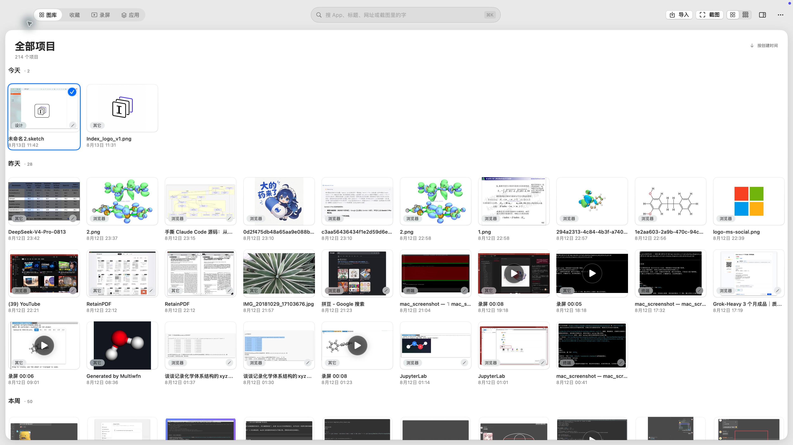
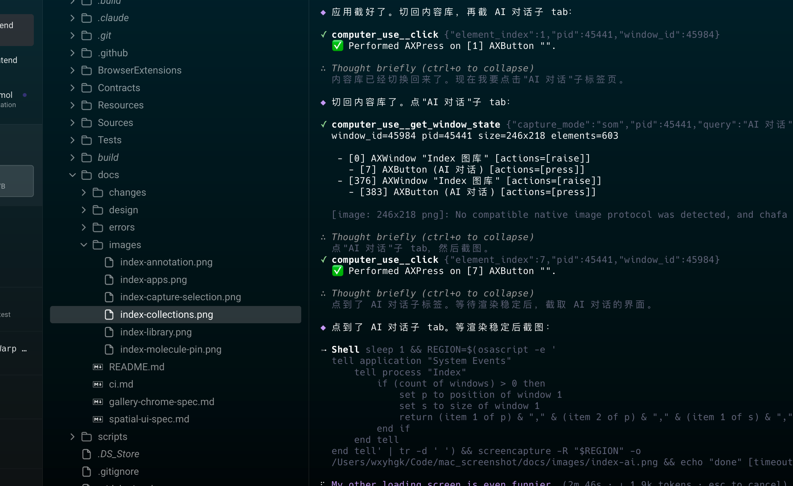

<p align="center">
  
</p>

<h1 align="center">Index</h1>

<p align="center">A macOS-native screenshot, annotation, and local-first image library — with a built-in AI agent.</p>

<p align="center"><b>English</b> · <a href="README.md">简体中文</a></p>

<p align="center">
  
</p>

<p align="center"><b>Freeze the screen → select → annotate with the Tool Palette → copy / save / pin / upload</b></p>

## Highlights

<table>
  <tr>
    <td width="68%"><br><b>One Tool Palette</b> — the same annotation tools serve capture, pinned images, and the library editor. The original stays untouched; every edit is a revision.</td>
    <td width="32%"><br><b>3D molecule pins</b> — copy XYZ, rotate to a useful view, freeze, annotate, then copy or save while keeping the original coordinates.</td>
  </tr>
</table>

- **Frozen capture** — all displays are frozen in one frame, so the selection and annotations always refer to the same pixels.
- **Cross-display selection** — drag a selection onto another display. Each display still renders its own frozen frame at native scale, and the output is stitched in global coordinates.
- **Content library** — screenshots, recordings, clipboard items, and AI conversations in one place, with OCR, tags, favorites, and search.
- **AI agent** — `⌘⇧A` opens an agent that can search screenshots, open images, manage plugins, and change settings; conversation history is persisted.
- **Privacy masking** — on-device Vision detects emails, phone numbers, bank cards, API keys, and faces. The library offers one-click masking, and the capture toolbar can detect and mask in one action.
- **Window shell / beautify** — macOS and browser shells, backgrounds, padding, rounded corners, shadows, and watermarks. The capture stage previews the composed result live and can switch shell styles.
- **OCR / translation** — OCR results are searchable and taggable; SelectionAI can translate (requires an OpenAI-compatible provider).
- **Screen recording / GIF** — record a region to MP4, concatenate segments, and export GIF. No timeline editor.
- **Structured clipboard** — copy colors, URLs, text, and images; paste recognizes the type automatically.
- **Non-destructive editing** — the original image is immutable; annotations are structured layers plus revision history.
- **Fast output** — pin, copy, save, upload, and drag-to-shelf all go through the same action pipeline.
- **Upload / sync** — a generic multipart image host endpoint plus WebDAV backup and restore.
- **Search-as-you-type plugin (experimental)** — works with WeChat/Apple Pinyin by default and recalls local content next to committed phrases; the bundled AOSP Pinyin source is an optional experimental component.
- **Chemistry workflow** — `copy XYZ → ⌃⌘M → rotate → freeze → annotate → output`.

## Workspace

<table>
  <tr>
    <td width="50%"><br><b>Library</b> — screenshots / recordings / clipboard / AI conversations in sub-tabs.</td>
    <td width="50%"><br><b>Collections</b> — manual groups that span sources.</td>
  </tr>
  <tr>
    <td width="50%"><br><b>Apps</b> — browse screenshots by source app.</td>
    <td width="50%"><br><b>AI conversation</b> — search screenshots, open images, and manage plugins in natural language.</td>
  </tr>
</table>

Every image above comes from a running copy of Index, not a design mockup.

## Feature matrix

> ✅ full · ◐ partial / needs configuration · — none. Competitor columns are based on their public READMEs
> as of 2026-10 and are for positioning only; check their latest releases for current behavior.

| Capability | Index | macshot | Snapzy | better-shot |
|---|:---:|:---:|:---:|:---:|
| Region / window / scrolling / cross-display capture | ✅ | ✅ | ✅ | ✅ |
| Annotation tools + non-destructive revisions | ✅ | ◐ | ◐ | ◐ |
| Sensitive-content detection / masking | ✅ | ✅ | ✅ | — |
| OCR | ✅ | ✅ | ✅ | ✅ |
| Translation | ◐ provider required | ✅ | ✅ | — |
| Screen recording / GIF | ✅ | ✅ | ✅ | ✅ |
| Video editing | — | ◐ | ✅ | ✅ |
| Window shell / background / watermark | ✅ | ✅ | ✅ | ✅ |
| Upload / cloud sync | ◐ generic upload + ✅ WebDAV | ✅ | ✅ | ✅ |
| Content library / history search | ✅ | ◐ | ◐ | ◐ |
| AI agent | ✅ | — | — | — |
| 3D molecule pins | ✅ | — | — | — |
| Homebrew / notarization / auto-update | — / ◐ / — | ✅ / ✅ / ✅ | ✅ / ✅ / ✅ | ✅ / ✅ / — |

## What makes Index different

Index is not trying to out-count annotation tools or out-edit video editors. The differentiation is:

1. **Library + AI retrieval** — screenshots, recordings, clipboard items, and AI conversations share one searchable, groupable, source-aware library.
2. **AI agent** — not a chat ornament: it can search images, open them, manage plugins, and change settings.
3. **3D molecule pins + chemistry workflow** — a vertical workflow none of the general screenshot tools cover.
4. **Non-destructive layers + revision history** — annotations are structured revisions, not a flattened final export.

## Build

Requires macOS 14+ and Xcode Command Line Tools.

```bash
./scripts/make-dev-cert.sh   # once per development machine
./build.sh release
open build/Index.app
```

The normal release build no longer bundles the experimental input method. To build it:

```bash
INDEX_BUILD_INPUT_METHOD=1 ./build.sh release
```

Before the first capture, allow Index in **System Settings → Privacy & Security → Screen Recording**, then relaunch the app.

Default shortcuts: capture `⌃⌘A` · scrolling capture `⌃⌘S` · record `⌃⌘R` · library `⌃⌘G` · AI agent `⌘⇧A` · 3D molecule `⌃⌘M`.

Development check: `./scripts/check.sh`

Input-method plugin and optional input-source build/install notes: [Search-as-you-type](docs/input-method.md).

Release artifacts: [GitHub Releases](https://github.com/wxyhgk/index/releases). The release workflow requires a
Developer ID certificate and Apple notarization credentials; it notarizes, staples, and verifies with Gatekeeper
before upload. Public preview artifacts may be ad-hoc signed; use a notarized build for normal distribution.

The SwiftPM target, executable, bundle ID, and `~/Library/Application Support/Index/` keep their internal names for
compatibility with existing permissions and data. The app bundle and display name users see are Index.

## Docs and license

[Architecture](ARCHITECTURE.md) · [Privacy](PRIVACY.md) · [Security](SECURITY.md) · [Third-party notices](THIRD_PARTY_NOTICES.md) · [Search-as-you-type](docs/input-method.md) · [Mac App Store](docs/app-store.md) · [CI](docs/ci.md)

[GNU General Public License v3.0 or later](LICENSE) (`GPL-3.0-or-later`).
