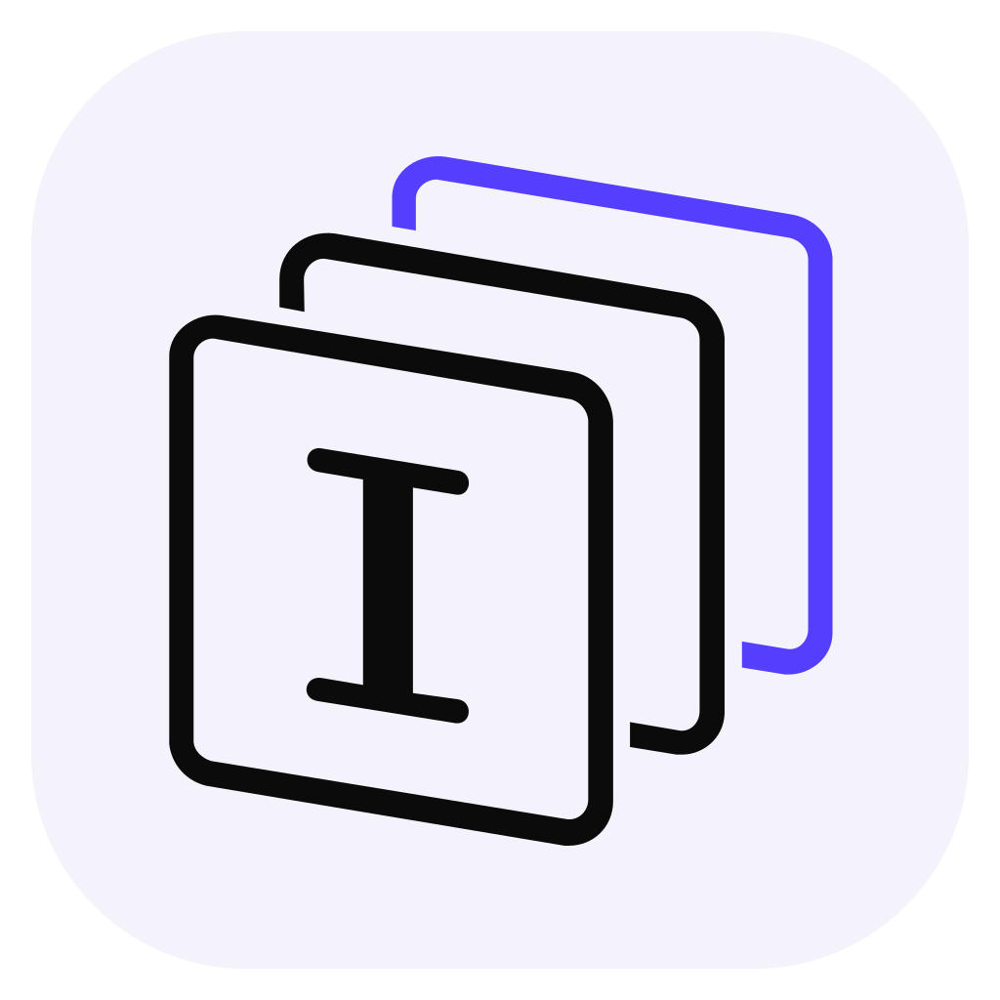
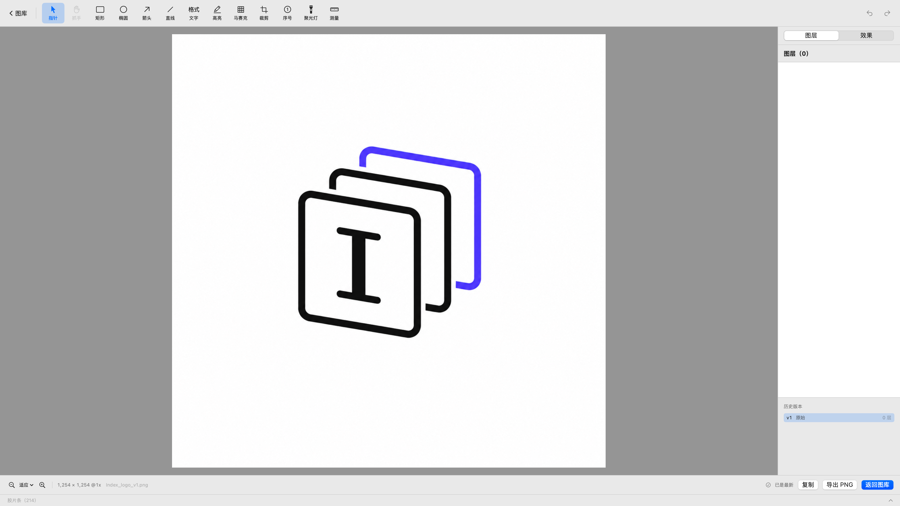
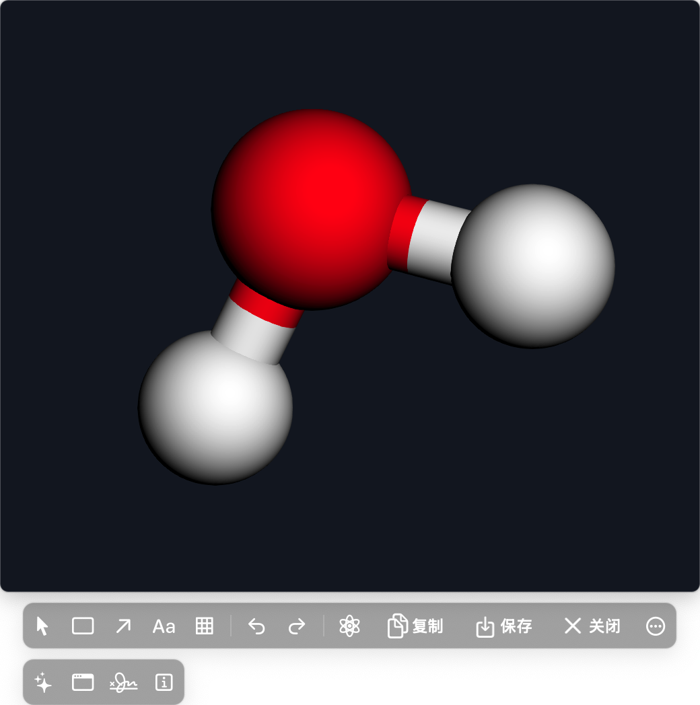
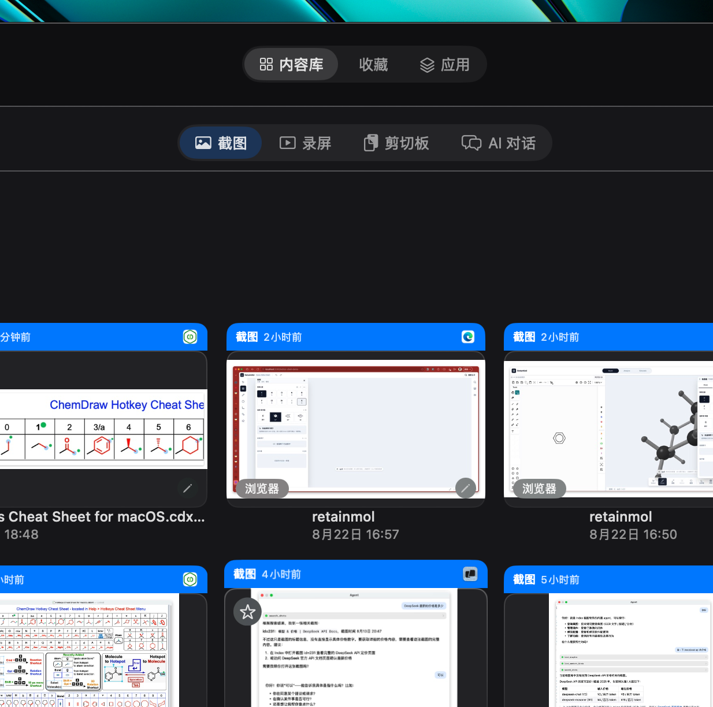
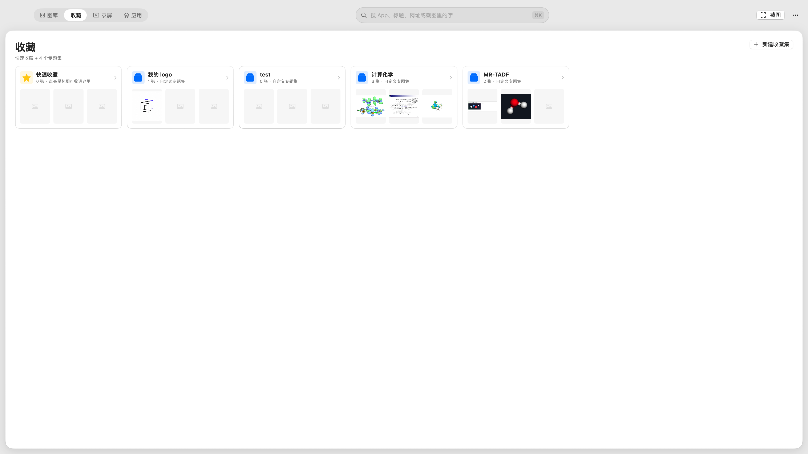
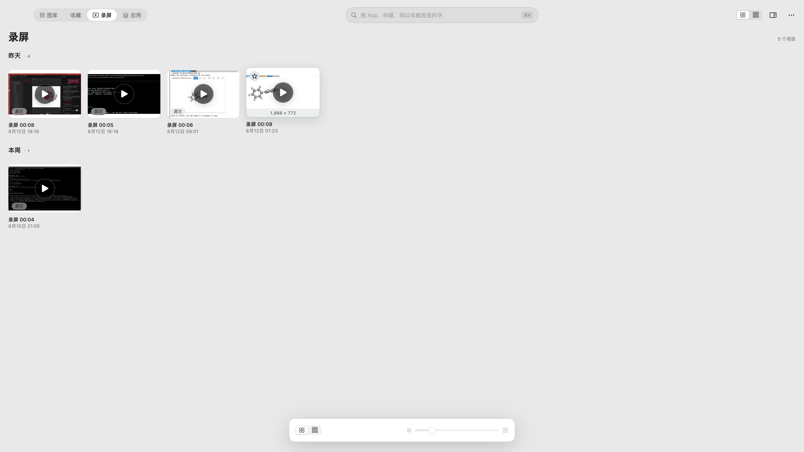
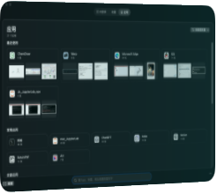

<p align="center">
  
</p>

<h1 align="center">Index</h1>

<p align="center">macOS 原生截图、标注与本地优先图片资料库。</p>

## 特色功能

<table>
  <tr>
    <td width="68%"><br><b>统一 Tool Palette</b> — 截图、钉图和图库编辑器共用同一套标注工具；原图不变，修订可回溯。</td>
    <td width="32%"><br><b>3D 分子钉图</b> — 复制 XYZ，旋转到合适视角后定格、标注、复制或保存，同时保留原始坐标。</td>
  </tr>
</table>

- **冻结截图**：多显示器画面一次冻结，框选与标注始终对应同一帧。
- **图片资料库**：截图、录屏、本地图片和浏览器图片统一入库，支持 OCR、标签、收藏与搜索。
- **非破坏性编辑**：原图不可变，标注保存为结构化图层和修订历史。
- **快速输出**：钉图、复制、保存、上传和拖拽暂存走同一套动作。
- **化学工作流**：`复制 XYZ → ⌃⌘M → 旋转 → 定格 → 标注 → 输出`。

## 四个工作区

<table>
  <tr>
    <td width="50%"><br><b>图库</b></td>
    <td width="50%"><br><b>收藏</b></td>
  </tr>
  <tr>
    <td width="50%"><br><b>录屏</b></td>
    <td width="50%"><br><b>应用</b></td>
  </tr>
</table>

全部图片均来自正在运行的 Index，不是界面设计稿。

## 构建

要求 macOS 14+ 与 Xcode Command Line Tools。

```bash
./scripts/make-dev-cert.sh   # 首次构建执行一次
./build.sh release
open build/MacShot.app
```

首次截图前，在“系统设置 → 隐私与安全性 → 屏幕录制”中允许 Index，然后重新打开 App。

默认快捷键：截图 `⌃⌘A` · 滚动截图 `⌃⌘S` · 录屏 `⌃⌘R` · 图库 `⌃⌘G` · 3D 分子 `⌃⌘M`。

开发检查：`./scripts/check.sh`

当前仍保留 `MacShot.app`、Bundle ID 和 `~/Library/Application Support/MacShot/`，以兼容既有授权与数据。

## 文档与许可

[架构](ARCHITECTURE.md) · [隐私](PRIVACY.md) · [安全](SECURITY.md) · [第三方声明](THIRD_PARTY_NOTICES.md) · [CI](docs/ci.md)

[GNU General Public License v3.0 or later](LICENSE)（`GPL-3.0-or-later`）。
